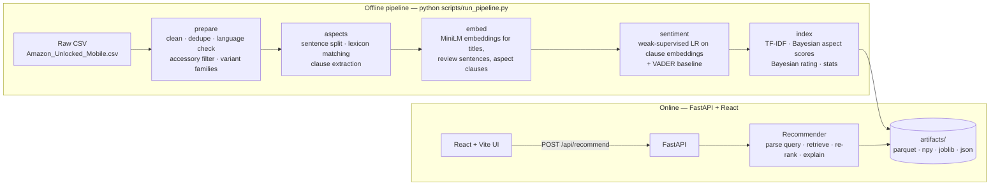

# Architecture

## Overview

The system has two halves:

- An **offline pipeline** does all the heavy computation once and writes artifacts to disk.
- An **online API** loads those artifacts at startup and answers queries in milliseconds.

Only the user's query is embedded at request time.

## Request flow (`POST /api/recommend`, method `hybrid`)

1. **Parse the query** (`ranking/query_parser.py`). The parser extracts:
   - aspects, with emphasis weights (1.0, or 1.5 for words like "excellent" or "must")
   - aspects to ignore ("don't care about…")
   - brands to include or exclude, including aliases such as "iPhone" → Apple
   - price limits ("under $300", "between 100 and 250")
2. **Filter.** Price and brand constraints are applied as hard filters, for every method.
3. **Embed the query.** MiniLM produces a 384-dimensional vector, cached with an LRU cache.
4. **Compute semantic relevance.** For every product:

   `R_sem = 0.4·cos(query, title) + 0.6·mean(top-5 cos(query, review sentences))`

   The sentence embeddings are stored grouped by product, so the per-product top-5 is one vectorised `np.partition` call.
5. **Build the candidate pool.** Take the top 100 eligible products by `R_sem`.
6. **Re-rank:** `S = α·R + β·A + γ·Q`, where:
   - `R` is `R_sem`, min-max scaled within the candidate pool
   - `A` is the weighted mean of the Bayesian-smoothed aspect scores for the requested aspects
   - `Q` is the Bayesian-average star rating, scaled to [0, 1]
7. **Explain.** For each requested aspect the response includes:
   - the score, mention counts, the catalogue average and a confidence value
   - up to two positive and one negative real review sentences, chosen by similarity to the query
   - the review sentences most similar to the query overall

## Components

| Layer | Module | Responsibility |
|---|---|---|
| Data | `reviewrec/data/load.py` | Map a source file to the standard review schema (adapter pattern) |
| Data | `reviewrec/data/clean.py` | Text cleaning, invalid rows, price outliers, accessories, duplicates, language flag |
| Data | `reviewrec/data/products.py` | Product families via review-overlap union-find; product-level statistics; seeded per-product cap |
| NLP | `reviewrec/text/*` | Normalisation, fingerprints, sentence and clause splitting |
| NLP | `reviewrec/aspects/lexicon.py` | Aspect lexicon; longest-match-wins overlap resolution |
| NLP | `reviewrec/aspects/sentiment.py` | VADER, weak-supervised logistic regression and optional transformer ABSA backends |
| NLP | `reviewrec/aspects/aggregate.py` | Bayesian smoothing of aspect scores and ratings |
| Retrieval | `reviewrec/retrieval/tfidf.py` | TF-IDF baseline (1–2-grams, sublinear TF) |
| Retrieval | `reviewrec/retrieval/semantic.py` | Embedder wrapper; vectorised title + review-evidence scoring |
| Ranking | `reviewrec/ranking/scoring.py` | Pure scoring functions (unit-tested) |
| Ranking | `reviewrec/ranking/recommender.py` | Orchestrates parse → filter → score → explain |
| Explain | `reviewrec/explain/*` | Evidence selection, reasons, comparison |
| Eval | `reviewrec/evaluation/*` | Metrics, blind pooling, runner, bootstrap CIs, kappa |
| API | `backend/app/*` | FastAPI routers, Pydantic schemas, startup loading |
| UI | `frontend/src/*` | Search, results with evidence, comparison, insights |

## Artifacts

| File | Content |
|---|---|
| `products.parquet` | One row per product family, with the Bayesian rating and quality |
| `title_embeddings.npy` | `[P, 384]` float32, L2-normalised |
| `sentence_embeddings.npy` | `[S, 384]` float16, grouped by product (memory-mapped) |
| `sentence_product_idx.npy`, `sentences_index.parquet` | Product index and text for each embedded sentence |
| `mentions.parquet`, `mention_embeddings.npy` | Aspect mentions with sentiment `v ∈ [-1, 1]` and clause embeddings |
| `product_aspects.parquet`, `aspect_priors.json` | Aggregated aspect scores and catalogue means |
| `tfidf_vectorizer.joblib`, `tfidf_matrix.npz` | TF-IDF baseline |
| `sentiment_model.joblib` | Weak-supervised classifier |
| `manifest.json`, `stats.json` | Provenance and dashboard statistics |

## Design decisions

- **No vector database.** About 1,000 products and about 200k sentences fit in memory. A brute-force matrix–vector product takes tens of milliseconds, so FAISS would add complexity without benefit at this scale.
- **Parquet and NumPy files instead of SQLite.** The data is read-only after the pipeline runs and is loaded once at startup.
- **The library is separate from the API.** `reviewrec` has no web code, so the pipeline, tests, evaluation and API all share one implementation.
- **The hashing embedder is for tests only.** Tests run offline in seconds. Real runs use Sentence Transformers.
